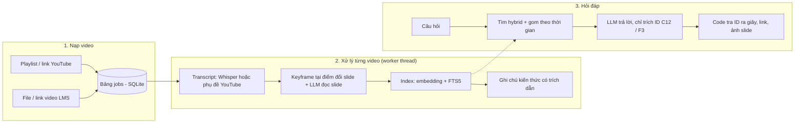

# Nhật ký triển khai: Lecture VideoRAG

> Bản chép tạm từ tab "Nhật ký triển khai" trong note của nhóm (ngày 28/11/2026). Sơ đồ kiến trúc trong note là
> widget nên được vẽ lại bằng Mermaid ở mục Kiến trúc.

Bản "đủ dùng" của master prompt: đầu vào là một chuỗi video bài giảng: file video LMS (tải lên hoặc link tải trực tiếp) hoặc YouTube (playlist / danh sách link), đầu ra là ghi chú kiến thức từng video và chat hỏi đáp cả chuỗi, mọi ý đều có timestamp, link `?t=` và frame. Code ở `Hackathon/lecture-videorag`, tách khỏi repo nộp bài hackathon.

## Kết quả chạy thật (27/11)

Chạy playlist 3Blue1Brown "Neural networks" (10 video) với `openai/gpt-4o-mini` qua OpenRouter; theo yêu cầu nhóm dừng sau 2 video đầu, 8 video còn lại để PENDING.

| Video | Thời lượng | Đoạn transcript | Slide cắt ra | Ghi chú | Ý bị bỏ vì thiếu trích dẫn |
| --- | --- | --- | --- | --- | --- |
| 1. But what is a neural network? | 18:40 | 22 | 53 (48 có nội dung) | 5 chủ đề, 10 ý | 0 |
| 2. Gradient descent, how neural networks learn | 20:33 | 17 | 60 | 4 chủ đề, 9 ý | 0 |

- **Ghi chú đúng nội dung**, viết tiếng Việt từ video tiếng Anh. Ví dụ: "784 nơ-ron đầu vào cho ảnh 28x28, 10 nơ-ron đầu ra" trích 02:52–03:41 + slide 01:44; "hàm chi phí = tổng bình phương sai khác" trích 03:42–05:02 + slide 03:56.
- **Chat** (3 câu thử): "Bias có vai trò gì?" trả lời đúng, trích 10:32–12:07 + slide 11:54; "Bao nhiêu lớp ẩn?" trả lời đúng 2 × 16 nơ-ron; "Thủ đô của Pháp?" từ chối vì bài giảng không nói tới.
- **Chi phí**: 118 lần gọi model, 4,23 triệu token vào / 12 nghìn token ra ≈ 0,64 USD cho 2 video (ước tính theo giá niêm yết gpt-4o-mini 0,15 / 0,60 USD mỗi triệu token, chưa đối chiếu hoá đơn OpenRouter). 99% là bước đọc slide: gpt-4o-mini tính ~37 nghìn token mỗi ảnh.
- **Giảm chi phí** nếu cần: đặt `LVR_MAX_FRAMES_PER_VIDEO=20` (ít slide hơn), hoặc `LVR_DESCRIBE_FRAMES=false` (bỏ đọc slide, vẫn có ảnh kèm trích dẫn), hoặc đổi sang model tính ảnh rẻ hơn.

## Cách tự demo

Dữ liệu 2 video đã xử lý nằm sẵn trong `data/live`, nên demo không cần chờ xử lý và không phụ thuộc mạng YouTube.

1. Mở terminal ở thư mục `Hackathon/lecture-videorag`.
2. Kiểm tra `.env` có: `LVR_LLM_PROVIDER=openai`, `OPENAI_API_KEY` (key OpenRouter), `LVR_OPENAI_BASE_URL=https://openrouter.ai/api/v1`, `LVR_OPENAI_MODEL=openai/gpt-4o-mini`, `LVR_DATA_DIR=data/live`.
3. Chạy `.venv/Scripts/python -m app`, mở http://127.0.0.1:8000. Góc trên phải phải hiện `openai/gpt-4o-mini`, không có chữ "thiếu API key".
4. Trang chủ → bấm chuỗi **Neural networks** → thấy 10 video, 2 video đầu "Xong".
5. Bấm tên **bài 1** → tab *Ghi chú kiến thức*: bấm một chip thời gian (vd "Bài 1 · 02:52–03:41") → player nhảy đúng đoạn; bấm ảnh slide bên phải để phóng to. Xem thêm tab *Slide* và *Transcript*.
6. Khung *Hỏi đáp* bên phải, hỏi lần lượt:
   1. "Bias trong mạng nơ-ron có vai trò gì?" → câu trả lời có chip trích dẫn, bấm là nhảy video.
   2. "Hàm chi phí được tính thế nào?" → trích từ bài 2 (chat tìm trên cả chuỗi).
   3. "Thủ đô của Pháp là gì?" → trợ lý từ chối vì bài giảng không nói tới (điểm khác biệt: không bịa).
7. Ô *Tìm trong cả chuỗi* ở trang chuỗi: gõ "sigmoid" hoặc "ham chi phi" (không dấu vẫn ra) → danh sách đoạn + slide có thời điểm.
8. (Tuỳ chọn, tốn phí) Bấm **▶ Xử lý** ở bài 3 để xem xử lý trực tiếp: thanh tiến độ chạy qua các bước, mất khoảng 4–6 phút và ~0,3 USD.

**Nếu gặp lỗi**: báo "thiếu API key" hoặc lỗi 401 → kiểm tra `OPENAI_API_KEY` trong `.env` (không có dấu cách thừa); trang trắng → kiểm tra đang chạy lệnh ở đúng thư mục; không có mạng → phần ghi chú, slide, tìm kiếm vẫn xem được, chỉ chat cần mạng (và player YouTube cần mạng).

**Demo video LMS** (dữ liệu đã xử lý sẵn ở `data/lms-e2e`): đổi `.env` thành `LVR_DATA_DIR=data/lms-e2e`, chạy lại app → chuỗi **Thử LMS** → bài 1 phát bằng trình phát trong app, bấm chip trích dẫn là tua tới đúng giây. Muốn thử tải lên trực tiếp: trang chủ → mục *Video bài giảng LMS* → chọn file .mp4 có tiếng → *Tải lên và xử lý* (video 19 phút mất ~4 phút, ~0,3 USD).

> Lưu ý khi lấy code từ GitHub: thư mục `data/` không nằm trong repo (đã gitignore), nên `data/live` và
> `data/lms-e2e` chỉ có trên máy đã chạy xử lý. Máy mới cần tự xử lý lại video.

## Quyết định kỹ thuật

| Hạng mục | Master prompt | Bản đủ dùng | Lý do |
| --- | --- | --- | --- |
| LLM | Nhiều provider | OpenAI GPT mặc định (`gpt-5-mini`); Claude và chế độ giả dùng được qua cấu hình | Nhóm chọn GPT API |
| Cơ sở dữ liệu | PostgreSQL | SQLite + SQLAlchemy 2.0 | Nhóm chốt; không cần server |
| Hàng đợi job | Celery + Redis | Worker thread trong app, trạng thái job lưu SQLite | Nhóm bỏ Redis; job vẫn theo dõi và chạy lại được |
| Triển khai | Docker Compose | Chạy trực tiếp bằng Python | Nhóm bỏ Docker |
| Tìm kiếm vector | Qdrant | Vector lưu SQLite, tìm bằng numpy, sau interface có thể thay Qdrant | Một chuỗi bài giảng chỉ vài nghìn vector, không cần server riêng |
| Tìm theo từ khóa | — | SQLite FTS5, gộp với tìm vector (hybrid) | Bắt được thuật ngữ, tên công thức chính xác |
| OCR + mô tả hình | PaddleOCR + VLM | LLM đọc frame tại điểm đổi slide, trả về chữ trên slide + mô tả | Một bước thay hai; đọc được tiếng Việt và công thức |
| Frontend | React + Vite | HTML/JS thuần do FastAPI phục vụ | Máy chưa có Node; không cần bước build |
| Transcript | Whisper | Whisper (faster-whisper, large-v3-turbo trên GPU) là đường chính; phụ đề YouTube chỉ dùng khi chọn chế độ auto/subtitles | Bài giảng LMS (đối tượng chính) không có phụ đề; YouTube chỉ để demo |
| Đầu vào | Link YouTube | File video LMS (tải lên / link tải trực tiếp) + YouTube; file LMS phát bằng trình phát HTML5 trong app | Video LMS không có link công khai kiểu youtu.be?t=, nên trích dẫn phải mở trong app |

## Kiến trúc

Hàng giữa ghi vào SQLite (đoạn transcript, slide, vector, chỉ mục FTS5, ghi chú); hàng dưới đọc lại chỉ mục đó khi có câu hỏi. Ở cả ghi chú và chat, LLM chỉ trích ID, nên timestamp luôn là thời điểm thật trong video.

## Kế hoạch theo giai đoạn

- [x] 1\. Khung dự án: cấu hình, SQLite, model dữ liệu, FastAPI, health check
- [x] 2\. Nạp video: nhận playlist/link, lấy metadata, tạo job, chống xử lý trùng
- [x] 3\. Transcript: phụ đề YouTube (vi/en), chia đoạn có timestamp
- [x] 4\. Hình ảnh: tải video, tìm điểm đổi slide, cắt frame, LLM đọc slide
- [x] 5\. Chỉ mục + tìm kiếm: embedding, FTS5, hybrid, gom theo thời gian
- [x] 6\. Ghi chú kiến thức từng video + chat hỏi đáp có trích dẫn
- [x] 7\. Giao diện web: thư viện video, tiến độ xử lý, ghi chú, chat, bấm là nhảy tới giây
- [x] 8\. Test tự động (47/47) + chạy thật playlist với GPT qua OpenRouter (2 video)
- [x] 9\. README + hướng dẫn chạy

## Nhật ký

Mới nhất ở trên cùng.

| Lúc | Đã làm | Kết quả / ghi chú |
| --- | --- | --- |
| 28/11 | Nạp video LMS: tải file lên (chọn nhiều file, xếp theo tên Bai 2 trước Bai 10) hoặc dán link tải trực tiếp; thêm video vào chuỗi có sẵn. File được giữ lại để Whisper đọc âm thanh, cắt slide và phát ngay trong app; trích dẫn trỏ tới trình phát trong app, bấm là tua đúng giây. Từ chối rõ ràng: sai định dạng, file không đọc được hình, file không có tiếng, link trả về trang đăng nhập LMS | 58/58 test qua (thêm 8 test). Chạy thật: tải lên file mp4 18:40 (42 MB, có tiếng) → xong trọn luồng trong 250 s, 22 đoạn transcript, 53 slide, ghi chú 10 ý đủ trích dẫn; chat hỏi về sigmoid trích đúng 09:42–11:20; mở trang bằng trình duyệt (Edge) thấy player mở đúng 2:50 khi bấm trích dẫn. Chưa đo với bài giảng tiếng Việt |
| 28/11 | Whisper thành đường chính lấy transcript (đối tượng chính là bài giảng LMS không phụ đề): `LVR_TRANSCRIPT_MODE` = `whisper` / `auto` / `subtitles`; model `large-v3-turbo` nạp 1 lần dùng cho mọi video; báo tiến độ trong lúc chuyển giọng nói | 50/50 test qua (thêm 3 test cho 3 chế độ). Chạy thật bài 1 (19 phút) bằng Whisper: xong trọn luồng trong 182 s, transcript khớp phụ đề gốc, ghi chú 12 ý đủ trích dẫn. Đo riêng: 180 s âm thanh / 14,5 s trên RTX 3050 4 GB (~12× thời gian thực). Chưa đo với bài giảng tiếng Việt |
| 27/11 | Chạy thật playlist 3Blue1Brown với `openai/gpt-4o-mini` qua OpenRouter; dừng sau 2 video theo yêu cầu | 2/2 video COMPLETED, ghi chú đúng nội dung và đủ trích dẫn, chat trả lời đúng và từ chối câu ngoài bài; ≈ 0,64 USD (ước tính). Chi tiết ở mục Kết quả chạy thật |
| 27/11 | Hỗ trợ OpenRouter (base URL + model có tiền tố `openai/...`); thêm nút ▶ Xử lý cho video đang chờ | 47/47 test qua |
| 27/11 | Đổi LLM sang OpenAI GPT theo góp ý trong note: thêm provider OpenAI (JSON schema strict, đọc ảnh slide, `reasoning_effort` theo từng bước), đặt làm mặc định; giữ Claude và chế độ giả để chuyển qua lại | 46/46 test qua (thêm 5 test cho provider OpenAI với client giả, không gọi mạng) |
| 27/11 | Chạy thật cả hệ thống với 2 video 3Blue1Brown (LLM ở chế độ giả) | Cả 2 video COMPLETED: 39 đoạn transcript, 113 slide; ghi chú có link `youtu.be/...?t=4` + ảnh; tìm "neuron holds a number" ra đúng đoạn 02:52; chat hỏi "Hàm sigmoid dùng để làm gì?" (tiếng Việt, video tiếng Anh) lấy đúng đoạn 09:42 |
| 27/11 | Smoke test YouTube thật (`scripts/smoke_youtube.py`) | Phụ đề 286 dòng → 22 đoạn trong 1 s; tải video 720p 23.8 MB / 11 s; 53 keyframe / 29 s cho video 19 phút, ảnh nét đúng nội dung |
| 27/11 | Giao diện web + README | Trang chủ (thống kê + thêm chuỗi), trang chuỗi (tiến độ từng video, tìm kiếm, chat), trang video (player YouTube, ghi chú, slide, transcript; bấm trích dẫn là player nhảy tới giây). Chưa mở thử bằng trình duyệt |
| 27/11 | Viết xong backend: nạp chuỗi video, xử lý từng video (metadata → transcript → keyframe → index → ghi chú), worker nền, tìm kiếm hybrid, chat, REST API | 41/41 test qua, không gọi mạng và không tốn phí API (dùng LLM giả + video slide tự sinh) |
| 27/11 | Cơ chế trích dẫn: model chỉ được trích ID đoạn `[C12]` / slide `[F3]`; code tra ra giây, link `?t=` và frame | ID không tồn tại hoặc thuộc video khác bị loại; ý không còn trích dẫn nào bị bỏ khỏi ghi chú (có test) |
| 27/11 | Xử lý lỗi | Phần hình ảnh lỗi thì video vẫn xong với cảnh báo; video không phụ đề và chưa cài Whisper thì báo lỗi rõ ràng; job đang chạy khi app tắt sẽ được chạy lại |
| 27/11 | Môi trường | pytest 9.2 cài sẵn trên máy bị lỗi nội bộ ngay cả với test 1 dòng → tạo `.venv` dùng chung thư viện hệ thống, ghim pytest 8.4 |

**Cần nhóm duyệt / cung cấp**

- Đã đổi sang OpenAI theo góp ý ("đổi sang dùng gpt api"): mặc định `LVR_LLM_PROVIDER=openai`, model `gpt-5-mini`. Cần điền `OPENAI_API_KEY` vào `.env`; chưa có key nên gọi GPT thật chưa kiểm chứng được.
- Nhóm xác nhận tên model GPT muốn dùng (đổi bằng `LVR_OPENAI_MODEL`). Model cần đọc được ảnh và hỗ trợ JSON schema.
- Claude vẫn dùng được: `LVR_LLM_PROVIDER=anthropic` + `ANTHROPIC_API_KEY`.
