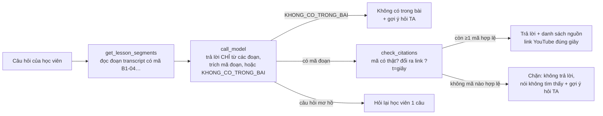

# AI SPEC — Tutor Pre-class A1 · Nhóm Aurora · Track A

> Mốc nộp: §7 chốt chuẩn "đạt" tại **CP2 19:30 Thứ Sáu 27/11** · §0–§7 nộp **CP3 10:00 Thứ Bảy 28/11** · đủ §0–§10 **CP4 14:30 Thứ Bảy 28/11** · §10 changelog ghi tiếp đến **23:59 Thứ Bảy 28/11**.

Track: [x] A — bài toán: Tối ưu trợ giảng AI trả lời câu hỏi dưới video có trích đúng nguồn bài, học viên tự kiểm được
Data BTC cấp đã dùng: data/preclass/ — answers.csv, chat.csv, events.csv (đã ẩn danh; không commit nguyên file)

## §0. Hiện tại việc này diễn ra thế nào *(guide 1.1)*
- Luồng hiện tại:
  1. Học viên xem video pre-class trên preclass-online.com
  2. Gặp câu hỏi kỹ thuật → gõ vào ô chat trợ giảng AI dưới video
  3. Trợ giảng AI trả lời (hiện tại trả lời dạng văn, không rõ trích từ đoạn nào)
  4. Học viên không biết câu trả lời đúng hay bịa → tìm lại thủ công trong video hoặc tin luôn
  5. Nếu tin sai → vào buổi lab với kiến thức thiếu/sai
- Công cụ / AI đang dùng: trợ giảng AI đã chạy thật trên trang pre-class (chưa kiểm cụ thể model/phiên bản)

## §1. Người dùng & bằng chứng *(guide 1.1, 1.2)*
- Người dùng chính: Học viên L3B tự học video pre-class trước buổi (không có TA bên cạnh)
- Việc họ cố làm xong: Hiểu đúng một khái niệm kỹ thuật trong bài trước buổi học sáng hôm sau
- Hôm nay họ giải bằng gì, hỏng ở đâu: Hỏi trợ giảng AI — nhưng câu trả lời không rõ lấy từ đâu trong bài, học viên không tự kiểm được; chưa bỏ vì không có lựa chọn khác
- Pain: Học viên — đang hỏi câu kỹ thuật dưới video pre-class — không biết câu trả lời có căn cứ trong bài không — học sai kiến thức hoặc mất thêm 5–10 phút tìm lại thủ công
- Bằng chứng — số chính (CP3, chi tiết `evidence/data-mining.md`): (A) chat log BTC: sau khi trợ giảng AI trả lời câu hỏi dưới video, **656/1091 (60%)** lượt học viên tua lùi video trong 5 phút (199/1091, 18%) hoặc hỏi tiếp trong 10 phút (548/1091, 50%) — 144 học viên. (B) bình luận công khai dưới 2 video bài giảng: **45/68 (66%)** câu hỏi về nội dung bài không ai trả lời; chỉ 1/23 câu trả lời chỉ mốc thời gian trong video. Giả thuyết CP1 (≥30% câu trả lời không trích đoạn) không đếm được vì data BTC không có chữ câu trả lời.

## §2. Impact & quyết định chọn *(guide 1.3)*

| Hướng | Bao nhiêu người gặp | Bao nhiêu lần / tháng | Mỗi lần tốn gì | Impact / tháng | Làm kịp không | Chọn? |
|---|---|---|---|---|---|---|
|  |  |  |  |  |  |  |
|  |  |  |  |  |  |  |
|  |  |  |  |  |  |  |

- **Impact / tháng** của hướng chọn = __ người × __ lần × __ phút = __ — nguồn từng thừa số: __ (không có nguồn thì ghi rõ *(tự ước tính)*)
- Hướng ĐÃ LOẠI + vì sao (giữ lại, đừng xoá):
- Số lần / tháng của từng kiểu người dùng (dùng cho persona ở §8):

## §3. Giải pháp tương tự *(guide 2.1)*
- [sản phẩm / tính năng gần giống]: một điều đáng học · một điều đáng né · mình khác gì

## §4. Thiết kế *(guide 2.2, 3.2)*
- **Lát cắt MỘT CÂU** (1 người dùng · 1 việc · 1 quyết định AI · 1 kết quả): Một học viên · hỏi một câu kỹ thuật dưới video bài giảng · trợ giảng quyết định trả lời kèm mã đoạn (hoặc nói "không có trong bài" / hỏi lại) · học viên bấm link mở đúng giây trong video để tự kiểm.
- Không làm (≥3 điều): không trả lời bằng kiến thức ngoài bài · không làm bài tập / quiz hộ, không chấm điểm · không tự gửi tin hay báo TA (chỉ gợi ý học viên hỏi TA) · không xử lý nhiều video cùng lúc hay tóm tắt cả khoá (để dự án `lecture-videorag` làm sau).
- **Sơ đồ** (Mermaid):

- **Hình dạng:** [x] workflow cố định · [ ] một agent · [ ] nhiều agent — Luồng luôn là đọc đoạn → model trả lời theo mã → code kiểm mã, không cần AI tự chọn bước. Bài giảng ngắn (39 đoạn ≈ 12k token) nên đưa hết vào context, không cần vòng lặp tìm kiếm; agent hay nhiều agent chỉ thêm chi phí, độ trễ và chỗ sai mà không thêm độ chính xác trích dẫn.
- **AI dựa vào đâu** — mỗi công cụ (khớp `codebase/tools.py`):

  | Công cụ | Input | Output | Tác động ra ngoài? |
  |---|---|---|---|
  | `get_lesson_segments` | mã bài (`B1`, `B2`; rỗng = mọi bài) | danh sách đoạn `{ma_doan, bai, start, end, text}` từ `data/lesson_segments.csv` | Không (chỉ đọc) |
  | `check_citations` | danh sách mã đoạn model trích | `{valid: [{ma_doan, link ?t=giây, khoang thời gian}], invalid: [mã bịa]}` | Không (chỉ đọc) |

- **Mức tự động:** [ ] AI gợi ý, người quyết · [x] AI tự làm khi chắc, chuyển người khi không · [ ] AI tự làm — Có mã đoạn hợp lệ thì trả lời ngay (học viên tự kiểm bằng link, sửa rẻ); không có căn cứ thì không trả lời mà chuyển sang TA. Sai thì học viên học sai kiến thức trước buổi lab và TA mất giờ sửa, nên không cho AI trả lời khi không có nguồn.
- **Chỗ chặn rủi ro** (rủi ro lớn nhất của lát cắt bị chặn ở đâu, bằng gì): Rủi ro lớn nhất là trả lời bịa hoặc trích nguồn sai. Chặn ở `check_citations` + `agent.py`: model không được viết thời gian, chỉ trích mã; code bỏ mã không tồn tại, đổi mã ra link đúng giây; câu trả lời không còn mã hợp lệ nào thì bị thay bằng câu "không tìm thấy trong bài".
- **Chỗ người duyệt** (việc AI không được tự làm): báo lỗi nội dung bài giảng, trả lời câu hỏi ngoài bài, chấm điểm / làm bài tập — AI chỉ gợi ý học viên hỏi TA; TA quyết định.
- **Nguyên tắc thiết kế** (≥3, bắt buộc G10):

  | Nguyên tắc | Chỗ cụ thể trên sơ đồ / trong bản chạy thử |
  |---|---|
  | G10 — thu hẹp phạm vi khi không chắc | Nhánh `KHONG_CO_TRONG_BAI` và nhánh "không mã nào hợp lệ" → không trả lời, gợi ý hỏi TA (`agent.py`, `SAFE_FALLBACK`) |
  | Mọi khẳng định kiểm chứng được | Model chỉ trích mã đoạn; `check_citations` đổi ra link `youtu.be/…?t=giây` để học viên bấm xem lại |
  | Code giữ sự thật, model giữ ngôn ngữ | Thời gian và link do code tra từ `lesson_segments.csv`, model không bao giờ tự viết timestamp |
  | Hỏi lại khi mơ hồ | Luật trong `SYSTEM` (`agent.py`): câu hỏi không rõ phần nào → hỏi lại 1 câu, không đoán |

- Phần nào còn giả (công cụ trả dữ liệu giả, model chế độ giả…) — ghi rõ, không giả làm thật: (1) Dữ liệu bài giảng là transcript 2 video 3Blue1Brown công khai, **dùng thay tạm** cho video pre-class Day08 vì data BTC chưa có trên máy chạy code — cần thay trước CP3. (2) Lượt chạy CP2 dùng model chế độ giả (`MODEL_PROVIDER` trống); đã viết sẵn nhánh gọi model thật qua OpenRouter/OpenAI trong `codebase/ai.py`.

## §5. Chỗ khó — 4 lớp + ≥6 kịch bản + 2 tấn công *(guide 2.3)*

| Kịch bản | Lớp (1–4) | Hành vi mong muốn (nói gì, hiện gì, cho làm gì tiếp) | Câu thử |
|---|---|---|---|
|  |  |  |  |
| *(tấn công)* |  |  |  |
| *(tấn công)* |  |  |  |

(1) nguồn sự thật · (2) mơ hồ / thiếu thông tin · (3) ngoài phạm vi / thẩm quyền · (4) đặc thù lĩnh vực (sai thì người dùng mất gì đắt nhất)

## §6. Bốn đường đi của trải nghiệm
- Mọi thứ suôn sẻ: · Không chắc (lớp 2): · Không có căn cứ (lớp 1): · Người dùng sửa:
- Bị đòi ngoài phạm vi (lớp 3): · Trường hợp đặc thù lĩnh vực (lớp 4):

## §7. Đánh giá & chuẩn "đạt" *(guide 2.4, 4.1)*
- Data card: `data/DATA_CARD.md` · bộ câu thử: `eval/benchmark.csv` — 26 câu (thuong 8 · kho 13 · tu_choi 5; 12/26 câu hỏi thật `data_that`) · metric: `eval/metric_spec.yaml` (3 metric)
- **Chuẩn "đạt"** (chốt **trước 19:30 Thứ Sáu 27/11**, giữ nguyên đến 23:59 Thứ Bảy 28/11): "Đạt khi ≥ 80% câu qua, và 0 mã đoạn bịa trong toàn bộ lượt chạy, và 100% câu tu_choi qua"
- Kết quả: lượt 1 15/26 (58%, chưa đạt: cần ≥80%; tu_choi 5/5, 0 mã bịa) · lượt 2 __/__ (__%) — run ID: run-1@20261128-090408 / __ → chi tiết `eval/report.md`, hồ sơ `eval/README.md`

## §8. Chi phí khi dùng thật *(guide 4.2)*
- Persona + giá: `cost/personas.yaml` · lượt mô phỏng: `cost/simulate-__.csv` (__ phiên)
- Chi phí / task thành công: __ (model __) · __ (model __)
- Chi phí / tháng ở quy mô thật: thấp __ · cơ sở __ · cao __ → chi tiết `cost/cost-estimate.md`
- So với impact / người / tháng (§2): đáng làm không, vì sao:

## §9. Rủi ro & an toàn
- Dữ liệu: đã ẩn danh gì, không thu gì, không đưa gì vào model gói miễn phí:
- AI **không được** làm gì kể cả khi người dùng yêu cầu:
- Ai có thể bị hại nếu AI sai, và nhóm chặn thế nào:

## §10. Phân công & changelog
- Phân công có tên (theo chặng, chia cặp — guide "Cách chia việc"): __
- Dùng AI vào việc gì (2–3 dòng; chi tiết `docs/ai-usage.md`):
- Nhật ký thay đổi — **mọi thay đổi sau CP2 19:30 Thứ Sáu 27/11 phải có dòng ở đây**:

**CP2 → CP4** (vd thu hẹp lát cắt, hỏi thêm người dùng, lần cải tiến trước lượt 2)

| Thời điểm | Đổi gì | Vì sao (trỏ về câu thử / lỗi / bằng chứng nào) |
|---|---|---|
| 28/11 09:08 | Đào chat log BTC (`evidence/count_chat_btc.py`, `evidence/data-mining.md` mục A); cập nhật §1 số chính | Kiểm giả thuyết CP1 bằng data BTC; chữ câu trả lời không có nên đo hành vi sau khi nhận trả lời |
| 28/11 09:00 | Thêm nguồn bằng chứng: đào bình luận công khai dưới 2 video bài giảng (`evidence/count_comments.py`, `evidence/data-mining.md` mục B); giả thuyết ghi trước lúc 08:57 | Data BTC chưa có trên máy chạy code; cần ≥1 nguồn đạt ngưỡng cho CP3 |
| 28/11 09:00 | `eval/benchmark.csv` 14 → 26 câu: thêm B15–B26 là câu hỏi thật của người học (`data_that`); không sửa câu cũ, không sửa metric / chuẩn "đạt" | CP3 cần 20–30 câu, ≥1/3 từ data thật (`run.py check` hết cảnh báo) |
| 28/11 09:04 | Nối model thật `openai/gpt-4o-mini` qua OpenRouter, chạy lượt 1 → `eval/run-1.csv`, `traces/run-1.jsonl` | CP3 yêu cầu kết quả lượt 1 gọi AI thật |
| 28/11 09:20 | Cải tiến cho lượt 2 (CP4): `data/lesson_segments.csv` thay chữ 17 đoạn B2 bằng phụ đề tiếng Anh gốc (giữ nguyên mã đoạn và mốc thời gian); `codebase/agent.py` sửa prompt: đối chiếu theo nghĩa khi khác ngôn ngữ, đọc đoạn quanh mốc thời gian trong câu hỏi, trả lời phần có trong bài, sửa tiền đề sai, chỉ hỏi lại khi câu hỏi trỏ tới thứ không xác định | Lượt 1: 7/11 câu trượt là từ chối nhầm (B10, B15, B18–B22), transcript B2 là bản dịch máy khó khớp; B06, B07, B11, B16 (`eval/report.md` §2) |
| 28/11 | Thêm `extras/lecture-videorag/` (chép từ repo riêng, commit `f9d489f`) làm hướng mở rộng sau hackathon; không thuộc bản chạy thử, không đổi `codebase/`, `run.py`, bộ câu thử hay kết quả các lượt | Lưu lại phần "không làm" ở §4 (nhiều video, tóm tắt cả khoá) để nhóm làm tiếp; ghi rõ ở `extras/README.md` để không nhầm là phần nộp |

**Sau CP4 (đến 23:59 Thứ Bảy 28/11)** (sửa theo góp ý — không sửa chuẩn "đạt", câu thử, số bằng chứng, kết quả các lượt đã chạy)

| Thời điểm | Đổi gì | Vì sao |
|---|---|---|
|  |  |  |
